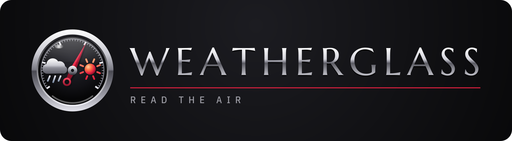
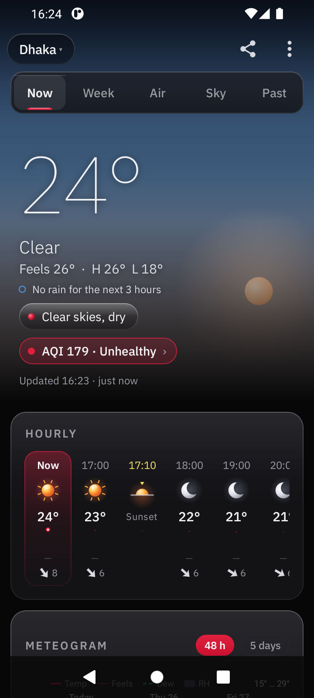
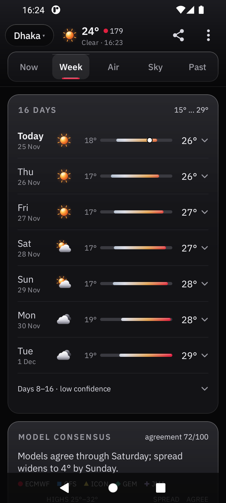
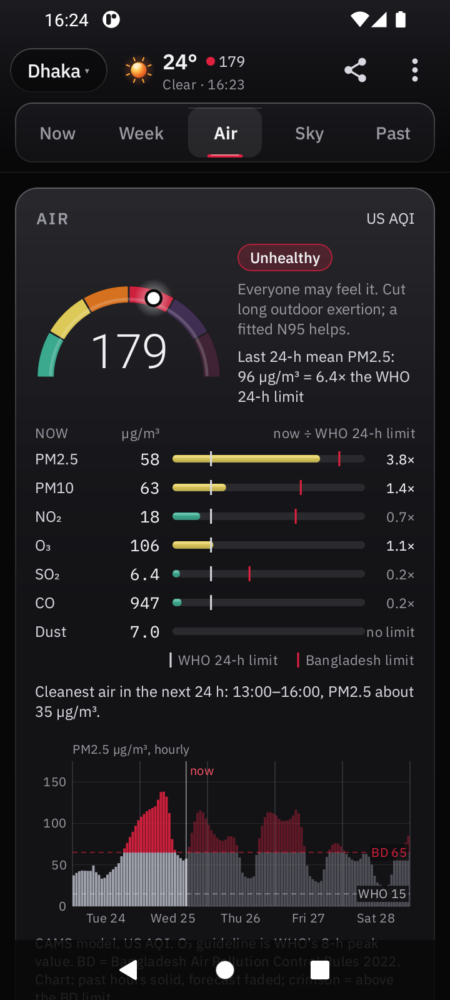
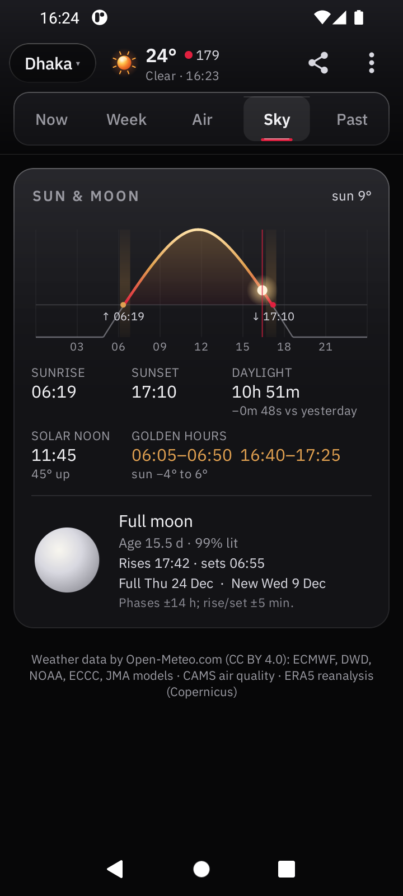
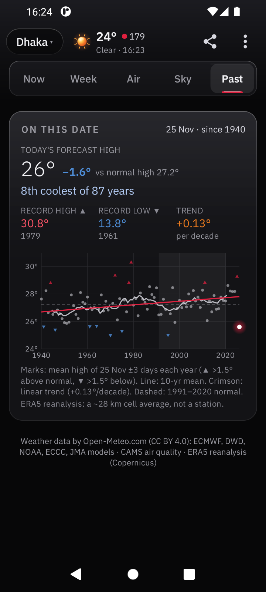
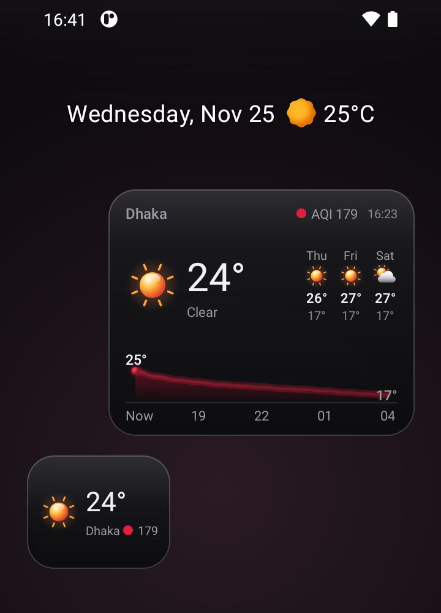
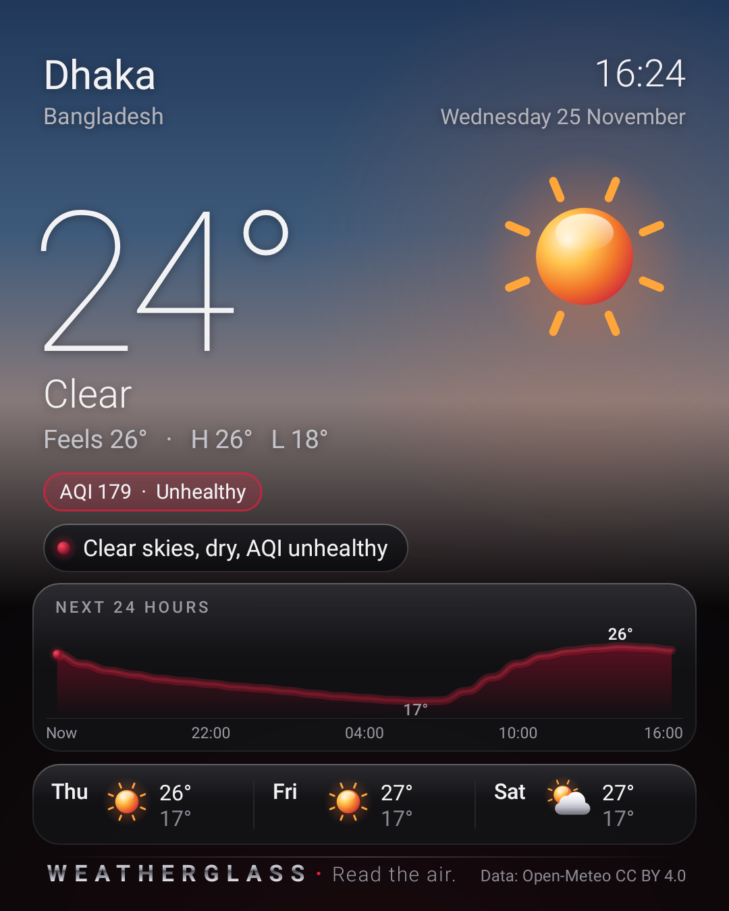

<p align="center">
  
</p>

<p align="center"><strong>Read the air.</strong></p>

Weatherglass is a weather instrument for Android. It shows what the forecast models say, how much they agree, what is in the air you breathe, and how today compares with every year since 1940, on a black glass dial built to be read at a glance.

It is made first for Bangladesh and South Asia, where heat, humidity, monsoon rain and polluted air matter more than a sun icon. It works anywhere in the world.

The name is the old household word for a barometer. For two centuries people tapped the weatherglass in the hall and watched the needle swing between Rain, Change and Fair; Admiral FitzRoy put them in fishing harbours across Britain in the 1860s so crews could read the coming weather. The app icon is one: an aneroid weatherglass face, chrome bezel and crimson needle.

## Why it's different

- **Model consensus.** ECMWF, GFS, ICON, GEM and JMA side by side for each day, with spread and wet/dry agreement. You see when the forecast is solid and when it is a guess.
- **Heat-work planner.** Wet-bulb temperature and heat index, and the safest hours of the day for hard outdoor work. Heat that's dangerous, not just hot.
- **86 years of context.** Today's forecast high placed against every year since 1940 from ERA5 reanalysis, with record high, record low, the 1991–2020 normal and the trend per decade.
- **The air, measured honestly.** US AQI plus PM2.5, PM10, NO₂, O₃, SO₂, CO and dust, each against the WHO guideline and Bangladesh's national standard. Not just one number.
- **Live sky.** The hero shows the real sky for the place: day or night and the actual moon phase.
- **Home-screen widgets** in the same black-glass style.
- **Shareable cards.** Send today's reading as an image.
- **Numbers first.** Real units (hPa, µg/m³, wet-bulb °C), short advice only where the science supports it, and the source and its limits on the card that uses them.
- **Runs on modest phones.** Tuned on a budget Unisoc handset: no blur, no heavy animation.

## Screenshots

| Now | Week | Air | Sky |
|---|---|---|---|
|  |  |  |  |

| Past | Widgets | Share card |
|---|---|---|
|  |  |  |

Get the APK from [Releases](https://github.com/sarwar-uddin/weatherglass/releases).

## Privacy

No account. No ads. No analytics, crash reporting or tracking libraries. There is no Weatherglass server.

- To get a forecast, the app sends a place's latitude and longitude to Open-Meteo. If you use your current location, the coordinates are rounded to about 1 km first.
- If you search for a place by name, the text you type goes to Open-Meteo's geocoding service.
- Saved places and settings stay on your phone.
- Permissions: approximate location (optional) and internet.

## Not an official warning service

Weatherglass shows what forecast models and reanalyses say. It does not issue warnings. For cyclones, floods, heatwaves and other severe weather, follow your national meteorological service (in Bangladesh, the Bangladesh Meteorological Department).

## Data sources and licences

- **Forecasts:** [Open-Meteo.com](https://open-meteo.com/), licensed [CC BY 4.0](https://creativecommons.org/licenses/by/4.0/), with model data from ECMWF, DWD, NOAA, ECCC and JMA.
- **Air quality:** Copernicus Atmosphere Monitoring Service (CAMS), via Open-Meteo.
- **Historical climate:** ERA5 reanalysis, Copernicus Climate Change Service (C3S), via Open-Meteo. Contains modified Copernicus information. ERA5 values are grid-cell averages, not station readings.
- **Fonts:** IBM Plex Sans and IBM Plex Mono, [SIL Open Font License 1.1](docs/branding/fonts/OFL.txt).

## Build

Requirements: JDK 21 and Android SDK 37.2 (platform and build tools).

```sh
./gradlew assembleRelease
```

The APK lands in `app/build/outputs/apk/release/`. Minimum Android version is 8.0 (API 26).

Brand assets, colour roles, type scale and store copy are in [`docs/branding/`](docs/branding/BRAND.md).

## License

Weatherglass is free software, licensed under the [GNU General Public License v3.0](LICENSE). Fonts are under the SIL OFL 1.1, and weather data is CC BY 4.0 (Open-Meteo, Copernicus).
